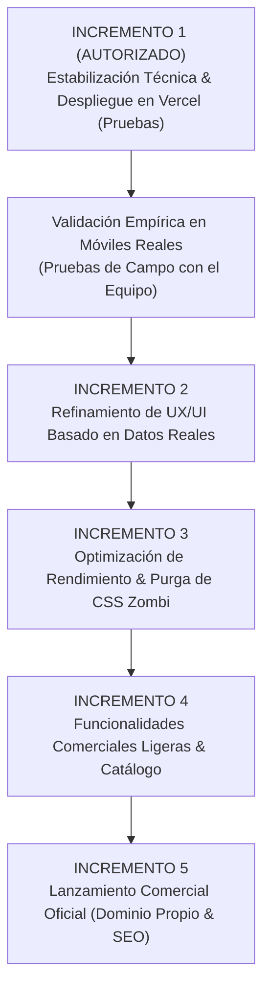

# 🗺️ GALYON — Hoja de Ruta Incremental Controlada (GALYON_INCREMENTAL_ROADMAP.md)

> **Metodología**: Planificación guiada mediante la skill `grill-me` (Antigravity & Obsidian Second Brain)  
> **Filosofía**: *Ponytail* (Lazy Senior Dev / YAGNI / Mínima Sobre-ingeniería)  
> **Versión Base**: v5.7.6  
> **Fecha de Certificación**: 1 de Noviembre de 2026  
> **Estado**: Incremento 1 Autorizado / Incrementos Posteriores Pendientes de Validación Empírica  

---

## 1. Diagnóstico del Alcance Actual

El proyecto GALYON cuenta con una base frontend funcional, ágil, ligera y estéticamente atractiva, construida en HTML5 semántico, CSS3 moderno (118 KB) y JavaScript Vanilla ES6+ (677 líneas). 

### Conclusiones Principales del Análisis de Código:
1. **La base no debe reconstruirse ni migrarse:** No se requiere React, Vue, Angular, Vite ni empaquetadores pesados. La arquitectura nativa de cliente responde a la perfección a las necesidades actuales.
2. **Existen cuatro deficiencias técnicas de bajo riesgo en reposo:**
   - Error de *case-sensitivity* en el enlace de la ficha técnica PDF (`index.html#L164`), que fallará con HTTP 404 en servidores Linux.
   - Escuchadores de eventos desconectados en los botones y puntos de las galerías en los modales de líneas (`script.js#L170-L225`).
   - Imagen del banner de mango (`assets/combo-mango-furioso-original.png`) sin comprimir con un peso de 3.3 MB.
   - Ausencia de metaetiquetas Open Graph en el `<head>`, lo que impide generar tarjetas con vista previa al compartir la URL en WhatsApp.
3. **No se debe sobrecargar el sistema prematuramente:** GALYON aún no requiere convertirse en una plataforma de e-commerce transaccional con backend, base de datos ni pasarelas de pago. Primero se debe pulir la experiencia actual y validar la tracción real con usuarios del campo ecuatoriano.

---

## 2. Necesidades Identificadas Durante la Entrevista Estratégica (`grill-me`)

A través de la entrevista exhaustiva realizada con el responsable del proyecto, se establecieron los siguientes acuerdos fundamentales:

1. **Prioridad Inmediata — Enfoque de Salida Rápida (MVP Limpio):** Resolver exclusivamente los cuatro problemas técnicos confirmados de la auditoría y poner el sitio web en línea sin dilaciones.
2. **Despliegue Progresivo en Vercel:** Publicar el Incremento 1 en la plataforma Vercel conectada al repositorio GitHub (`AaronCarvajalV/galyon`), pero manteniéndolo en **etapa de pruebas y validación interna** (sin divulgarlo aún a clientes comerciales reales).
3. **Auditoría Visual Empírica en Dispositivos Reales:** Probar la URL de Vercel en teléfonos móviles reales con diferentes resoluciones y condiciones de red para descubrir los verdaderos puntos de dolor de UX antes de modificar el diseño o la lógica del Asesor y el Carrito.
4. **Tratamiento Ordenado de la Deuda Técnica:** Separar la purga de CSS huérfano (52 clases zombis) y la consolidación de notas históricas en un incremento específico de optimización técnica, evitando introducir riesgos de regresión visual en la fase de estabilización.
5. **Estrategia Híbrida de Dominio:** Usar el subdominio gratuito de Vercel o un dominio comunitario gratuito (`.us.kg`) durante las fases de prueba (Incrementos 1 al 4), y adquirir/conectar el dominio comercial definitivo (`.com` o `.com.ec`) únicamente en el Incremento 5 al momento del lanzamiento público oficial.

---

## 3. Funcionalidades que se Mantienen Expresamente Fuera de Alcance

Para proteger el proyecto de sobre-ingeniería y costos innecesarios, las siguientes áreas quedan **formalmente pospuestas y excluidas** de esta etapa:

* ❌ **Pasarelas de Pago:** Cero integración con Stripe, Kushki, Payphone ni tarjetas de crédito. El cierre comercial se mantiene 100% coordinado por WhatsApp.
* ❌ **Bases de Datos en Servidor:** No se aprovisionarán bases de datos PostgreSQL ni MySQL por el momento.
* ❌ **Registro y Autenticación de Usuarios:** Sin login, contraseñas, JWT ni sesiones de clientes.
* ❌ **Backend y Microservicios:** No se crearán APIs en Python, Node.js ni PHP.
* ❌ **Agentes Autónomos de Inteligencia Artificial:** Ni chatbots en WhatsApp ni agentes de telefonía de voz en esta etapa.
* ❌ **Sistemas de Logística y Trazabilidad de Guías:** Sin integración automatizada de transportadoras (Servientrega, Enetsa).

---

## 4. Hoja de Ruta Flexible por Incrementos (Roadmap)



---

## 5. Descripción Técnica de Cada Incremento

### 🟢 INCREMENTO 1: Estabilización Técnica & Despliegue en Pruebas (Vercel)
* **Objetivo:** Subsanar los 4 problemas críticos de bajo riesgo y publicar una versión funcional en Vercel para pruebas privadas del equipo.
* **Alcance Técnico:**
  1. `index.html#L164`: Corregir mayúsculas a `fichas-tecnicas/galyon_insecta_metarhizium_anisopliae.pdf`.
  2. `script.js#L170-L225`: Agregar escuchadores de evento `click` a `.tricho-gallery-prev`, `.tricho-gallery-next` y `.tricho-gallery-dots button` reutilizando la función `manual(step)` ya existente.
  3. `assets/combo-mango-furioso-original.png`: Convertir a WebP comprimido (calidad 82%, ~250 KB) conservando las dimensiones exactas 1672×941 px sin recorte, y actualizar el atributo `src` en `index.html`.
  4. `index.html#L3-L15`: Añadir etiquetas OpenGraph (`og:title`, `og:description`, `og:image`, `og:url`) y Twitter Card.
  5. Despliegue en Vercel vinculado al repositorio `AaronCarvajalV/galyon` en rama `main`.
* **Archivos Afectados:** `index.html`, `script.js`, `assets/combo-mango-furioso-original.png` (y su contraparte WebP).

---

### 🟡 INCREMENTO 2: Refinamiento de UX/UI Basado en Datos Reales
* **Objetivo:** Corregir las fricciones de usabilidad y visualización descubiertas durante las pruebas móviles de la versión desplegada en Vercel.
* **Alcance Tentativo (A confirmar tras pruebas):**
  - Ajustes de espaciado y tamaños de fuente en el Asesor de Cultivos para pantallas angostas (<380 px).
  - Claridad visual del desglose de envíos en el drawer del carrito.
  - Formato del mensaje saliente predeterminado hacia WhatsApp para capturar datos esenciales (nombre del agricultor y cultivo).
* **Archivos Afectados:** `styles.css`, `script.js`.

---

### 🟡 INCREMENTO 3: Optimización de Rendimiento & Purga de Deuda Técnica
* **Objetivo:** Dejar el código base 100% limpio, ligero y mantenible para el largo plazo.
* **Alcance Técnico:**
  - Purgar las 52 clases CSS zombis identificadas en la auditoría dentro de `styles.css` (ahorro de ~25 KB).
  - Evaluar unificación de iconos SVG inline repetitivos mediante un `<svg>` sprite reutilizable.
  - Fusionar los 8 archivos dispersos `cambios_v*.txt` en un único `CHANGELOG.md` estructurado.
* **Archivos Afectados:** `styles.css`, `index.html`, archivos de texto en raíz.

---

### 🟡 INCREMENTO 4: Funcionalidades Comerciales Ligeras & Catálogo
* **Objetivo:** Perfeccionar la oferta comercial visible antes de la salida al mercado abierto.
* **Alcance Tentativo:**
  - Evaluar incorporación formal del combo "Rey Aguacate" si el cliente lo aprueba comercialmente.
  - Incorporar fichas técnicas en PDF para TRICHO y BACT si el equipo técnico las suministra.
  - Refinar los textos de ayuda y dosificaciones en el catálogo de productos y sustrato.
* **Archivos Afectados:** `index.html`, `script.js`, `fichas-tecnicas/`.

---

### 🟡 INCREMENTO 5: Preparación de Lanzamiento Comercial Oficial
* **Objetivo:** Abrir la tienda al público agrícola de Ecuador con identidad corporativa blindada.
* **Alcance Técnico:**
  - Vinculación del dominio comercial definitivo (`.com` o `.com.ec`) mediante DNS seguras en Cloudflare o Vercel.
  - Implementación de cabeceras de seguridad HTTP (`_headers` o `vercel.json` con CSP, HSTS, X-Frame-Options).
  - Verificación final de SEO y auditoría de accesibilidad WCAG AA.
* **Archivos Afectados:** `vercel.json` / `_headers`, configuración de DNS.

---

## 6. Dependencias y Orden Recomendado

```text
Incremento 1 (Estabilización & Vercel Staging)
      ↓ (Obligatorio: Pruebas del equipo en celulares reales)
Incremento 2 (UX / UI empírica)
      ↓
Incremento 3 (Limpieza de CSS y Deuda)
      ↓
Incremento 4 (Refinamiento Comercial)
      ↓
Incremento 5 (Lanzamiento en Dominio Oficial)
```

Ningún incremento debe iniciarse sin haber probado y validado el incremento anterior en el entorno de pruebas de Vercel.

---

## 7. Criterios de Aceptación Globales (DoD)

1. **Cero Dependencias Externas Innecesarias:** Se prohíbe la instalación de paquetes npm o frameworks en todas las fases.
2. **Cero Regresiones:** Ninguna modificación debe deshabilitar el carrito, el Asesor de Cultivos o la apertura de modales.
3. **Mantenimiento de Precios e Identidad:** Los 4 combos se mantienen en $70 con envío gratis en Ecuador a menos que exista orden expresa del usuario.

---

## 8. Estrategia de Pruebas

* **Prueba 1 — Descarga de Ficha Técnica:** Verificar que el archivo PDF se descargue y previsualice en dispositivos Android, iOS, Safari y Chrome en servidores Linux.
* **Prueba 2 — Control Manual de Carrusel:** Abrir cada modal (`#detalle-tricho`, `#detalle-bact`, `#detalle-insecta`) y hacer clic en las flechas y puntos, comprobando que las fotos cambien y los indicadores se actualicen.
* **Prueba 3 — Inspección de Red (Network Tab):** Certificar que la imagen del combo de mango se transfiera en formato WebP con un peso inferior a 350 KB.
* **Prueba 4 — Vista Previa en WhatsApp:** Compartir el enlace generado por Vercel en un chat privado de WhatsApp y validar que aparezca el título, la descripción y el logotipo de GALYON.
* **Prueba 5 — Checkout:** Agregar 1 combo y 1 producto suelto; presionar "Enviar pedido por WhatsApp" y verificar que el texto desglosado incluya la regla de envío correcta y la ciudad indicada.

---

## 9. Riesgos Identificados y Mitigación

| Riesgo Técnico | Impacto | Medida de Mitigación |
| :--- | :--- | :--- |
| **Descuadre del Banner en Lightbox** | Medio | Al convertir el PNG a WebP, preservar exactamente la relación de aspecto 1672×941 px para que `combo-lightbox.js` no distorsione la imagen. |
| **Caché en WhatsApp al compartir enlaces** | Bajo | Una vez inyectadas las etiquetas OpenGraph, probar el enlace en el depurador oficial de Facebook/WhatsApp Sharing Debugger para forzar la actualización de caché. |
| **Regresión en navegadores Safari antiguos** | Bajo | Verificar que el soporte de `<dialog>` en `combo-lightbox.js` conserve su fallback `setAttribute('open', '')`. |

---

## 10. Recomendaciones Técnicas de Ingeniería

1. **Mantener la disciplina de commits atómicos:** Cada fix del Incremento 1 debe contar con un commit limpio y descriptivo en Git.
2. **No adelantar optimizaciones estéticas:** Esperar a que el usuario pruebe la web en Vercel antes de proponer cambios en colores, tamaños de botones o distribución de secciones.
3. **Preservar el número oficial:** Asegurarse de que toda URL de WhatsApp apunte de forma inmutable al número oficial de GALYON: `593968933445`.

---

# 🎯 INCREMENTO ACTUAL AUTORIZADO

> [!IMPORTANT]
> **ESTADO DE AUTORIZACIÓN: ACTIVO**  
> De conformidad con la entrevista estratégica, **únicamente el Incremento 1 está formalmente aprobado para ejecución**. Los Incrementos 2, 3, 4 y 5 quedan en estado de borrador planificado y requerirán una sesión de validación específica posterior.

### Nombre del Incremento:
**Incremento 1 — Estabilización Técnica y Despliegue en Vercel (Staging / Pruebas)**

### Objetivo:
Corregir los cuatro problemas técnicos confirmados de la auditoría y publicar el proyecto en Vercel para pruebas internas en dispositivos móviles reales, sin alterar el diseño visual ni la lógica de negocio.

### Alcance Específico Autorizado:
1. **Fix `BUG-001`:** Corregir en `index.html#L164` la ruta del PDF a minúsculas exactas: `fichas-tecnicas/galyon_insecta_metarhizium_anisopliae.pdf`.
2. **Fix `BUG-002`:** Enlazar en `script.js` los escuchadores de evento `click` para los botones `.tricho-gallery-prev`, `.tricho-gallery-next` y los botones con atributo `data-slide` en las galerías de los modales.
3. **Fix `PERF-001`:** Convertir `assets/combo-mango-furioso-original.png` (3.3 MB) a WebP optimizado (1672×941 px, <350 KB) y actualizar el atributo `src` en la tarjeta de combos en `index.html`.
4. **Fix `SEO-001`:** Inyectar en el `<head>` de `index.html` las metaetiquetas Open Graph (`og:title`, `og:description`, `og:image`, `og:url`) y Twitter Card con la miniatura de GALYON.
5. **Despliegue Vercel:** Conectar el repositorio GitHub `AaronCarvajalV/galyon` (rama `main`) a Vercel para generar la URL de pruebas interna.

### Criterios de Aceptación para Dar por Terminado el Incremento 1:
- [ ] La ficha técnica PDF abre y se descarga sin error 404 en Linux y navegadores móviles.
- [ ] Los botones anterior, siguiente y los puntos selectores de las tres galerías rotan las fotografías al hacer clic manual.
- [ ] El banner del combo Mango Furioso pesa menos de 350 KB y se visualiza completo en el lightbox.
- [ ] Al compartir el enlace en WhatsApp, se genera la tarjeta visual de GALYON.
- [ ] La web está desplegada en una URL funcional de Vercel para pruebas del equipo.
